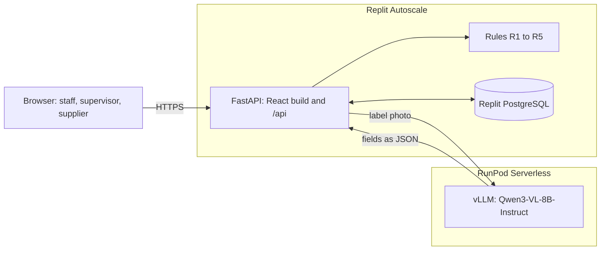

# Halal Supplier Control

> Checks every ingredient delivered to a halal-certified micro food business
> against its Raw Material Masterlist and the supplier's halal certificate,
> for the business's receiving staff and its Halal Supervisor.

---

## Team information

| Field | Details |
|---|---|
| **Team Name** | README later |
| **Team Domain** | Domain 2 (Orbyte Smart SME Challenge) |
| **SDG Track (1-17)** | SDG 8, Decent Work and Economic Growth |
| **Team Leader** | Jay Hu |
| **University** | Xiamen University Malaysia |
| **Number of Members** | 5 |

## Links

| Resource | Link |
|---|---|
| GitHub Repository | https://github.com/deettoh/halal-supplier-control |
| Live Demo | https://halal-supplier-control--dedoh.replit.app |
| RunPod Endpoint | https://api.runpod.ai/v2/l1ii8siifzdfan/openai/v1 (calls need a RunPod API key) |
| Slide Deck | - |
| Demo Video | - |
| Proposal | [submission/SDC2026_READMElater_Preliminary.pdf](submission/SDC2026_READMElater_Preliminary.pdf) |
| Technical & Tools Declaration | [submission/SDC2026_READMElater_TechDeclaration.pdf](submission/SDC2026_READMElater_TechDeclaration.pdf) |
| Replit proof of use | [submission/SDC2026_READMElater_Replit_POU.pdf](submission/SDC2026_READMElater_Replit_POU.pdf) |
| RunPod proof of use | [submission/SDC2026_READMElater_Runpod_POU.pdf](submission/SDC2026_READMElater_Runpod_POU.pdf) |

---

## Overview

### Problem

A halal-certified micro food business has to show at any audit that every
ingredient comes from a supplier with a current, in-scope halal certificate,
and today that proof is kept in folders, WhatsApp photos and spreadsheets. An
expired supplier certificate counts the same as none. A supplier can also
deliver a different brand of the same ingredient, and nobody notices until an
auditor compares the labels with the masterlist. A failed audit can lead to
suspension of the certificate and the loss of customers who depend on it.

### Solution

At receiving, staff photograph the delivered item's label. A vision model
reads the product name, brand, manufacturer and halal mark, and five rules
check them against the masterlist and the supplier's certificate. A clean
delivery is logged automatically. Anything else waits for the Halal
Supervisor, who accepts or rejects it with a reason. Substitutions and expired
certificates are caught at the door instead of at the audit, and one supplier
renewal in the shared registry updates every SME that buys from that supplier.

| Step | In Halal Supplier Control |
|---|---|
| Trigger | A delivery arrives and staff photograph its label |
| Data | The SME's masterlist and the shared supplier certificate registry |
| Decision | The model reads the label, and rules R1 to R5 give the verdict |
| Approval | Only the Halal Supervisor can accept or reject a flagged delivery with a required reason |
| Outcome | Verdict with a rule checklist, delivery status, masterlist coverage and an activity log row |

The app reports whether the documents on file cover an item. It doesn't rule
on whether anything is halal.

### Key features

- **Verdict with a rule checklist.** Rules R1 to R5 compare the label fields
  with the masterlist and the supplier's active certificate, and the verdict
  shows which rule failed.
- **Supervisor review.** Only the Halal Supervisor can accept or reject a
  flagged delivery, and each decision needs a reason.
- **One certificate registry for every SME.** When a supplier renews a
  certificate once, every SME that buys from that supplier sees its own items
  change from Expiring to Covered.
- **Activity log.** Every check, decision and renewal is logged with the role,
  action and time.
- **Review when the model fails.** A timeout or endpoint error on a photo
  with no cached label saves the delivery for the supervisor with the error
  recorded.

### Tech stack

| Layer | Technology |
|---|---|
| Frontend | React 19, Vite and Tailwind CSS |
| Backend | Python 3.11, FastAPI, Pydantic and SQLAlchemy |
| Database | PostgreSQL (Replit PostgreSQL in production) |
| AI / Compute | Qwen3-VL-8B-Instruct on a RunPod Serverless vLLM endpoint |
| Hosting / Dev | Replit Autoscale and Replit Secrets |

---

## Project structure

To list the top level, run `git ls-tree --name-only HEAD`.

```text
.
├── .github/workflows/       # CI for the backend and frontend checks
├── docs/                    # Architecture, API, database, deployment and demo guides
│   └── images/              # Screenshots from the live site
├── runpod/
│   ├── README.md            # Endpoint setup, health check and warm-up
│   └── endpoint.json        # RunPod Serverless endpoint settings
├── src/
│   ├── backend/             # FastAPI app, rules, model client and database
│   ├── frontend/            # React app
│   └── seed/                # Fictional seed data and certificate images
├── submission/              # Required submission documents
│   ├── SDC2026_READMElater_Preliminary.pdf      # Proposal
│   ├── SDC2026_READMElater_TechDeclaration.pdf  # Technical & Tools Declaration
│   ├── SDC2026_READMElater_Replit_POU.pdf       # Replit proof of use
│   └── SDC2026_READMElater_Runpod_POU.pdf       # RunPod proof of use
├── tests/                   # Backend and frontend-contract tests
│   └── eval/                # Synthetic label set, scorer and live results
├── .env.example             # Example environment variables
├── .gitattributes
├── .gitignore
├── .replit                  # Replit build and run configuration
├── compose.yaml             # Local PostgreSQL for development
├── LICENSE
├── pyproject.toml           # Python dependencies
├── uv.lock                  # Pinned Python dependency versions
└── README.md
```

### Architecture

FastAPI on Replit serves the React app and the API, and stores everything in
Replit PostgreSQL. The backend sends each label photo to Qwen3-VL-8B-Instruct
on a RunPod Serverless endpoint, which returns the fields as JSON, and Python
rules decide the verdict.



More detail is in these docs:

- [Architecture](docs/architecture.md): diagram, stack and the delivery check
- [API reference](docs/api.md): routes, rules and error codes
- [Database](docs/database.md): tables, local PostgreSQL and the demo reset
- [Deployment](docs/deployment.md): Replit build, Secrets and releases
- [RunPod endpoint](runpod/README.md): model settings and warm-up
- [Demo walkthrough](docs/demo.md): demo script and screenshots
- [Evaluation](tests/eval/README.md): label set, scorer and live results
- [Frontend](src/frontend/README.md): modes, routes and checks
- [Seed data](src/seed/README.md): the fictional dataset format

---

## How to run

### Run on Replit

1. Import this repository into Replit from GitHub.
2. Create a PostgreSQL database in the Database tool, then set the Secrets
   listed in [the deployment guide](docs/deployment.md):
   `DATABASE_URL`, `RUNPOD_ENDPOINT_URL` and `RUNPOD_API_KEY`.
3. Select Publish. The build in `.replit` builds the React app and installs
   the Python packages from `uv.lock`, and the app creates its tables and
   loads the seed data on first start.

Run in the workspace serves the API only, because the React build is part of
the publish step.

### Run locally

You need Python 3.11 or later with [uv](https://docs.astral.sh/uv/), Node 24
with pnpm 11, and Docker for the local PostgreSQL.

```bash
uv sync
cp -n .env.example .env   # add RUNPOD_ENDPOINT_URL and RUNPOD_API_KEY for label reading
docker compose up -d --wait postgres
uv run --env-file .env uvicorn backend.main:app --app-dir src --reload
```

In a second terminal, start the frontend and open the URL it prints:

```bash
pnpm --dir src/frontend install --frozen-lockfile
pnpm --dir src/frontend dev
```

Without the RunPod variables, uploads are saved as Reading incomplete
(`needs_human`). The API docs are at http://127.0.0.1:8000/docs.

Python dependencies are declared in `pyproject.toml` and pinned in `uv.lock`,
so the repo has no `requirements.txt`. To produce one, run
`uv export --frozen --no-dev --no-hashes --no-emit-project -o requirements.txt`.

### Run tests

```bash
uv run pytest -q
uv run ruff check --select E,F,I src tests
uv run mypy src/backend tests
pnpm --dir src/frontend test --run && pnpm --dir src/frontend lint
```

CI runs the backend and frontend checks on every pull request and on `main`.
At this commit, `uv run pytest -q` reports 259 passed and 114 skipped, where
the skipped tests need PostgreSQL (`--run-db`) or the live endpoint
(`--run-live`). `pnpm --dir src/frontend test --run` reports 81 passed.

---

## How we use Replit

- **Hosting.** A Replit Autoscale deployment serves the React build and the
  API at the live demo link. The publish build installs Node 24 from Nix,
  builds the frontend with pnpm and installs the Python packages with uv.
- **Database.** Replit PostgreSQL stores the masterlists, certificates,
  deliveries with their label photos, and the activity log. The published app
  has its own production database, separate from the workspace's development
  database.
- **Secrets.** `DATABASE_URL`, `RUNPOD_ENDPOINT_URL` and `RUNPOD_API_KEY` are
  Replit Secrets, and the repository holds no keys.
- **Workspace.** The team pulls `main` into the Replit workspace to publish,
  and uses its Shell for the live model test and the production database
  reset.

Proof of use: [`submission/SDC2026_READMElater_Replit_POU.pdf`](submission/SDC2026_READMElater_Replit_POU.pdf)

## How we use RunPod

- **Workload.** Qwen3-VL-8B-Instruct reads the product name, brand,
  manufacturer and halal mark from each delivery's label photo.
- **Setup.** A RunPod Serverless endpoint runs the stock vLLM worker, so the
  repo has no `handler.py`. The endpoint's settings are in
  [`runpod/endpoint.json`](runpod/endpoint.json), and
  [the RunPod guide](runpod/README.md) covers creating, checking and warming
  the endpoint.
- **Integration.** `src/backend/extract.py` sends each photo through the
  OpenAI Python SDK to the endpoint's OpenAI-compatible URL, with a JSON
  schema for the reply and the timeout set in `TIMEOUT_SECONDS`.
- **Cost.** Between dry runs, the endpoint uses the `scaling` values in
  `runpod/endpoint.json`. Before a dry run or judging, the team sets one
  active worker so the first check doesn't wait for a cold start.

The endpoint serves the OpenAI chat API, so a request looks like this:

```bash
curl -sS "$RUNPOD_ENDPOINT_URL/chat/completions" \
  -H "Authorization: Bearer $RUNPOD_API_KEY" \
  -H "Content-Type: application/json" \
  -d '{"model": "qwen/qwen3-vl-8b-instruct", "messages": [{"role": "user", "content": "Reply with the word OK."}], "max_tokens": 5}'
```

Proof of use: [`submission/SDC2026_READMElater_Runpod_POU.pdf`](submission/SDC2026_READMElater_Runpod_POU.pdf)

---

## Challenges and learnings

- **Cold starts.** With no worker running, the first request waits for a
  worker to start, and in testing that wait took 2.5 minutes or more, close to
  the request timeout set in `TIMEOUT_SECONDS`. The team warms one worker
  before each dry run, and seven of the eight evaluation photos have a cached
  label that is served if the endpoint call fails.
- **TLS on Replit.** The certificate directory in Replit's environment lacked
  the root certificate for RunPod's API, so the client verifies TLS against
  the certifi bundle.
- **Prompt changes.** Two rounds of prompt rewording made the live results
  worse, because one left a visible halal mark unread and the other read a
  SAMPLE sticker as the product. The first prompt stayed.
- **Lesson.** Scoring every prompt change against the same eight cases caught
  both regressions before deployment.

## Future improvements

- Pre-fill the renewal form from a certificate photo. The route
  `POST /api/certificates/extract` is defined but returns 501.
- Take certificates from suppliers and label photos from staff through
  WhatsApp with the Meta Cloud API.
- Check each certificate against Verify Halal or MYeHALAL.
- Run a scheduled sweep that marks expiring certificates and sends renewal
  reminders to suppliers.
- Pilot the module with one certified premise and time the in-app check
  against the [82-second manual baseline](tests/eval/README.md) on a larger
  set of labels.

## Team

| Name | Role | GitHub |
|---|---|---|
| Jay Hu | Team Lead / AI Inference & Deployment | [@deettoh](https://github.com/deettoh) |
| Nigel Cheong Tze Hock | Frontend & AI Evaluation | [@nigelcheong1](https://github.com/nigelcheong1) |
| Lee Yi Hong | Frontend & Pitch | [@YiHong-12](https://github.com/YiHong-12) |
| Tan Ching Yang | Backend & Database | [@fakedpotato1](https://github.com/fakedpotato1) |
| Evelyn Chan Yee Syen | Rules Engine, Demo Data & Proposal | [@evelyn926](https://github.com/evelyn926) |

---

## Submission checklist

- [x] Team name, domain (Domain 1 / Domain 2) and SDG track filled in
- [ ] Slide deck link added
- [ ] Demo video link added
- [x] Replit used, with proof of use in `submission/`
- [x] RunPod used, with proof of use in `submission/`
- [x] Preliminary submission completed (`SDC2026_TeamName_Preliminary.pdf`)
- [x] Technology declaration completed (`SDC2026_TeamName_TechDeclaration.pdf`)
- [ ] Submission files renamed with your team name (replace `TeamName`)
- [ ] "How to run" steps verified
- [x] No API keys or secrets committed to the repository

## License

This project is licensed under the [Apache License 2.0](LICENSE).
