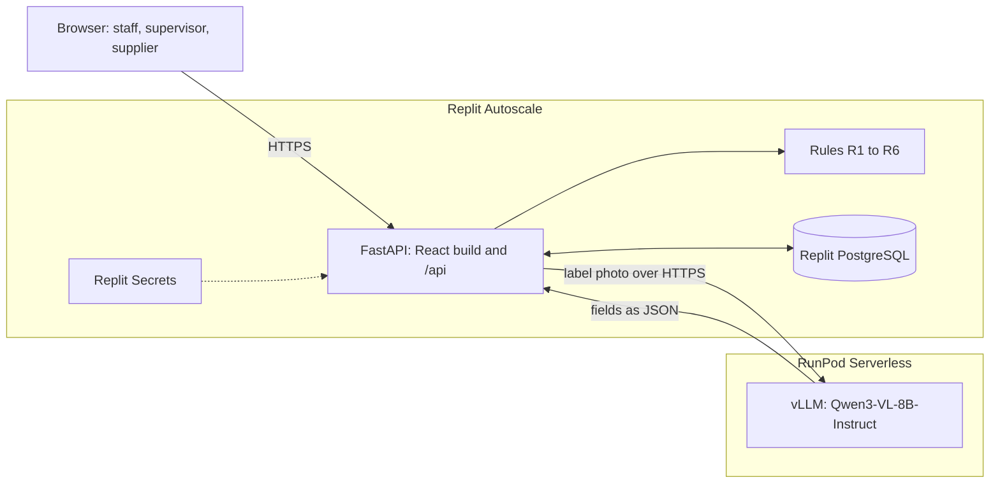

# Architecture

Halal Supplier Control is one Replit Autoscale deployment and one RunPod
Serverless endpoint. Replit runs the app and its database, and RunPod runs
the vision model. Only the model call leaves Replit.



## One web service and one model endpoint

| Part | Choice |
|---|---|
| Frontend | React 19 with Vite and Tailwind CSS |
| Backend | FastAPI on Python 3.11 with Pydantic models for every request body and JSON response |
| Database | PostgreSQL through SQLAlchemy, with photos stored as JPEG in the database |
| Model | Qwen3-VL-8B-Instruct (bf16) on a RunPod Serverless vLLM endpoint with a 24 GB GPU |
| Model client | OpenAI Python SDK pointed at the endpoint's OpenAI-compatible URL, with a JSON schema for the output |
| Matching | rapidfuzz for the brand and the manufacturer comparisons in rule R2 |
| Hosting | Replit Autoscale and Replit Secrets |

Instead of an agent framework, the app makes one model call per delivery with
a 180-second timeout, then runs Python rules and saves a status on the
delivery.

## A delivery check, step by step


A Covered or Expiring delivery is accepted automatically. Substitution, Not
covered and Reading incomplete wait in the review queue, and the supervisor
accepts or rejects with a reason. When R1 to R5 pass and the label has no
visible halal mark, R6 fails and the verdict is Reading incomplete. The rule
table and the API routes are in [the API reference](api.md).

## SMEs share one supplier registry

Certificates belong to suppliers instead of SMEs. Each material in an SME's
masterlist points to a supplier, and the backend computes coverage for that
material from that supplier's active certificate on every read. A renewal from
a supplier stays pending, with no effect on coverage, until a registry
reviewer verifies or rejects it with a note. Verifying makes the renewal
active and supersedes the old certificate, and every linked SME sees the new
coverage on its next request. Rejecting keeps the old certificate active. The
backend adds a row to each linked SME's activity log for the submission and
for the decision, with the person's name as the actor. SMEs don't see each
other's materials or deliveries.

## Without a label reading, the supervisor reviews the delivery

Extraction is the only feature that depends on RunPod. After the endpoint
idles, the first request waits while a worker loads the model, and in testing
that wait took 2.5 minutes or more. When the call fails or runs past the
180-second timeout, the backend uses the stored reading in
`src/backend/demo_cache.json` if the photo is a prepared demo photo. For any
other photo, it saves the delivery as Reading incomplete for the supervisor.
Before a demo, set one active worker as described in [the RunPod
guide](../runpod/README.md).

## Two Orbyte services are simulated

The app is built as an Orbyte module and simulates two Orbyte platform
services:

- Login and organisations come from the `X-Demo-Role` and `X-Demo-Tenant`
  headers set by the workspace picker.
- Supplier records are the seeded `suppliers` table.

## Where each part of the code is

To list these folders, run
`ls -d runpod src/backend src/frontend src/seed tests tests/eval submission docs`.

```text
runpod/       RunPod endpoint settings and warm-up steps
src/backend/  FastAPI app, services, rules, model client and database
src/frontend/ React app
src/seed/     Fictional seed data and certificate images
tests/        Backend, frontend-contract and evaluation tests
tests/eval/   Synthetic label set, scorer and live results
submission/   Submission PDFs
docs/         API, architecture, database, deployment and demo guides
```
