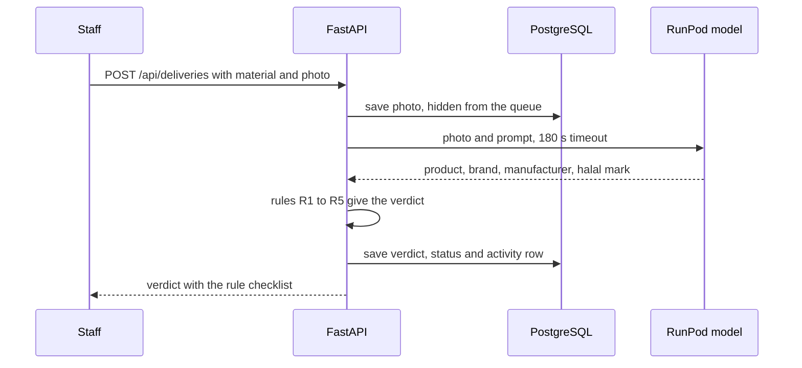

# Architecture

Halal Supplier Control is one Replit Autoscale deployment and one RunPod
Serverless endpoint. Replit runs the app and its database, and RunPod runs
the vision model. Only the model call leaves Replit.


## One web service and one model endpoint

| Part | Choice |
|---|---|
| Frontend | React 19, Vite and Tailwind CSS, built to static files that FastAPI serves |
| Backend | FastAPI on Python 3.11, with Pydantic models for every request and response |
| Database | PostgreSQL through SQLAlchemy, with photos stored as JPEG in the database |
| Model | Qwen3-VL-8B-Instruct (bf16) on a RunPod Serverless endpoint with the vLLM worker, 24 GB GPU tier |
| Model client | OpenAI Python SDK pointed at the endpoint's OpenAI-compatible URL, with a JSON schema for the output |
| Matching | rapidfuzz for the brand and manufacturer comparison in rule R2 |
| Hosting | Replit Autoscale with Replit Secrets, built from this repo |

The app has no agent framework: it makes one bounded model call per delivery,
then runs Python rules and saves a status on the record.

## A delivery check, step by step



A Covered or Expiring delivery is accepted automatically. Substitution, Not
covered and Reading incomplete wait in the review queue, and the supervisor
accepts or rejects with a reason. The rule table and the API routes are in
[the API reference](api.md).

## SMEs share one supplier registry

Certificates belong to suppliers instead of SMEs. Each material in an SME's
masterlist points to a supplier, and its coverage is computed from that
supplier's active certificate on every read. When a supplier renews, the new
certificate becomes active, the old one becomes superseded, and every linked
SME sees the new coverage on its next request. Each SME's activity log gets a
`certificate_renewed` row. SMEs don't see each other's materials or
deliveries.

## A failed model call leaves the delivery for review

Extraction is the only feature that depends on RunPod. After the endpoint
idles, the first request waits while a worker loads the model, about three
minutes in testing. A call that fails or passes the 180-second timeout saves
the delivery as Reading incomplete for the supervisor. For the prepared demo
photos, the backend serves a stored reading from `src/backend/demo_cache.json`
in that case. Before a demo, set one active worker as described in [the RunPod
guide](../runpod/README.md).

## Two Orbyte services are simulated

The app is built as an Orbyte module, and two Orbyte platform services are
simulated:

- Login and organisations come from the `X-Demo-Role` and `X-Demo-Tenant`
  headers set by the workspace picker.
- Supplier records are the seeded `suppliers` table.

## Where each part of the code is

To list these folders, run
`ls -d runpod src/backend src/frontend src/seed tests tests/eval submission docs`.

```text
runpod/       RunPod endpoint settings and warm-up steps
src/backend/  FastAPI app, services, rules, model client, database
src/frontend/ React app
src/seed/     Fictional seed data and certificate images
tests/        Backend, frontend-contract and evaluation tests
tests/eval/   Synthetic label set, scorer and live results
submission/   Submission PDFs
docs/         API, architecture, database and deployment guides
```
