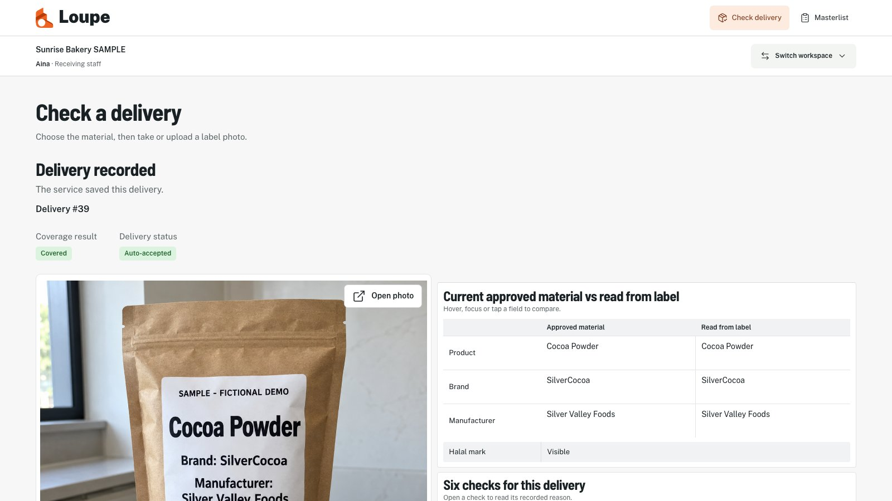
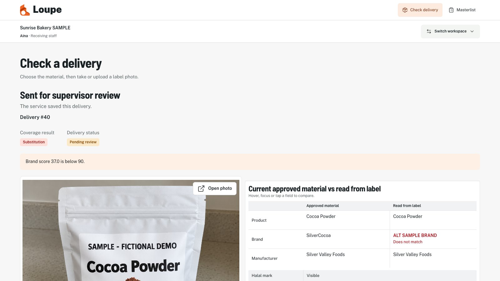
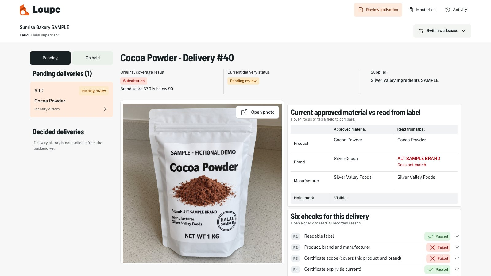
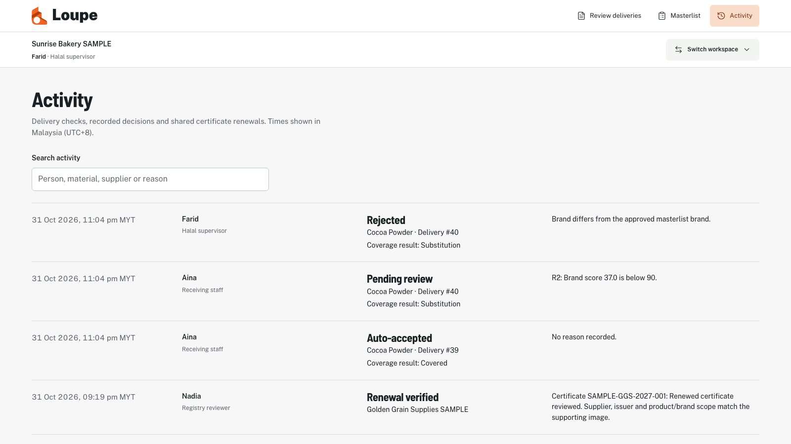

# Demo walkthrough

Open the [live demo](https://halal-supplier-control--dedoh.replit.app),
select Enter demo, and pick a SAMPLE person, who comes with a role and an
organisation. The demo script follows the project brief:

1. As the Halal Supervisor of Sunrise Bakery SAMPLE, open Masterlist. Wheat
   Flour shows Expiring.
2. As Receiving staff, check a Cocoa Powder delivery with a clean label. The
   verdict is Covered and the delivery is accepted automatically.
3. Check another Cocoa Powder delivery from a different brand. The verdict is
   Substitution, with rule R2 failed, and the delivery is queued for the
   supervisor.
4. As the supervisor, open Review deliveries and reject it with a reason.
5. Open Activity to see each step with the person, action and time.
6. Switch to Crescent Caterer SAMPLE. Its Wheat Flour from the same supplier
   also shows Expiring.
7. As the supplier Golden Grain Supplies SAMPLE, fill in the renewed
   certificate and select Submit renewal for review. The renewal waits as
   pending, and Wheat Flour still shows Expiring.
8. As the registry reviewer, open Registry renewals, write a review note and
   select Verify renewal. Both SMEs now show Wheat Flour as Covered.

On the live site, use a label photo from
[`tests/eval/images/`](../tests/eval/images/), for example `L01.png` (clean)
or `L02.png` (different brand). The first check after the endpoint has been
idle can take 2.5 minutes or more.

## Screenshots from the live site

| Covered delivery | Substitution flagged |
|---|---|
|  |  |
| Supervisor review | Activity log |
|  |  |
