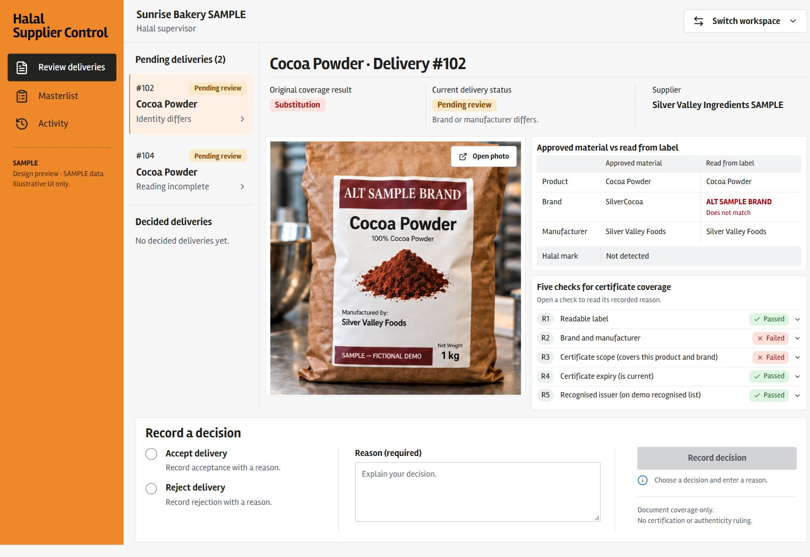

# Frontend completion and review — 23 October 2026

The complete frontend is on `codex/frontend-redesign`, with main **95ab738** integrated during PR cleanup. The original `Frontend` branch remains at **27e96f8**, untouched. All seven routes are implemented: introduction, role/organisation entry, receiving, review, masterlist, activity and supplier certificates/renewal. Read [DEVELOPMENT.md](DEVELOPMENT.md) for commands and [INTEGRATION_HANDOFF.md](INTEGRATION_HANDOFF.md) for supported APIs and deployment boundaries.

Cleanup note: intermediate design-tool files, root design briefs, implementation plans and duplicate source plates were archived outside the repository. Historical reviewer reports describe the files and commit IDs present during their review; those IDs are preserved in a local backup branch, while PR #69 has consolidated history. The shipping photographs and review fixes remain unchanged. Landing-page copy and animation proposals are a separate, unimplemented follow-up.

JPEG follow-up: the four shipping PNGs were replaced with full-resolution progressive JPEGs, reducing their total size from **8,363,651 to 919,137 bytes (89% smaller)**. JPEG EXIF descriptions identify the synthetic derivatives and source PNG hashes. References and prepared-example hashes now use JPEGs; fixture comparison confirms no seed/rule/result changes. A new regression first failed on the old hard-coded PNG MIME type, then passed while preserving the prepared JPEG's MIME and bytes. Fresh checks: **53 frontend tests**, **4 Python fixture checks**, frontend lint/build and targeted Ruff checks passed. All four JPEGs were visually inspected; original evaluation/seed images are unchanged. The shorter landing/animations remain separate in draft PR #72.

Fresh cleanup verification on main **95ab738**, with all five requested paths physically absent: **52 frontend tests and 4 Python preview-fixture checks passed**, frontend lint/build passed, and all four public PNG hashes are unchanged. Full Python checks also passed: **231 passed, 105 skipped**, Ruff check/format and mypy clean. The two former plate imports now use the identical public image; Vite no longer allows reads outside the frontend package for those assets. Git ignores prevent reintroducing the removed tool directories and briefs.

## Independent review and corrections

Separate fresh reviewers performed the [code review](reviews/2026-10-23/code-review.md), [Intent/visual assessment](reviews/2026-10-23/assessment-a.md), and isolated [detector/browser assessment](reviews/2026-10-23/assessment-b.md). The visual assessment finished before detector findings were read. Detector ran exactly once: **0 findings**. No mutable browser overlays were available or claimed. Initial model-capacity failures were retried successfully; these were independent reviews, not an author-only substitute.

Three Important code findings were reproduced with failing tests and fixed in commit **89bac2b**:

- Pending decisions now lock queue selection until success or conflict completes; a late response cannot replace another delivery's reason.
- Indexed browser Back/Forward cancellation preserves the existing draft and forward history. App links and page unload also warn about unsaved work.
- New prepared checks select Python-generated results for the renewed registry state. Prior saved checks retain their original result. There is no browser coverage engine.

Two P2 visual findings were corrected in the same batch: rule rows now have explicit disclosure cues/instructions, and Manufacturer stays intact on phone/narrow desktop comparisons. The independent [verdict pass](reviews/2026-10-23/finish-verdict.md) resolved both and returned **ship** for those fixes, with no material regression. This verdict does not claim production certification. Pre-correction exact-comp comparison was 93%; later functional cue/label adaptations were reviewed visually, not assigned a new pixel score.

[Implemented phone receiving screenshot](reviews/2026-10-23/mobile.png). Captures are actual application evidence, separate from earlier image mockups. Native browser screenshot size/scrollbar rounding is documented in the review reports; PNG copies preserve the original JPEG capture pixels.

## Final verification on updated main

- Frontend: **52 tests passed**, lint and production build passed; frozen install previously passed with unchanged lockfile. One concurrent cold-run navigation test timed out loading the lazy route; isolated and complete-suite reruns passed. No functional assertion was removed or failure converted into a success.
- Python after merging PRs #67/#68 and synchronizing the locked environment: **231 passed, 105 skipped**; Ruff check/format and mypy passed. Explicit PostgreSQL/live opt-ins were not run.
- Shipping raster provenance: both scans found **4 rasters, 0 missing**. Original prompt/origin records are archived locally outside the repository; embedded provenance remains in the shipping PNGs under `src/frontend/public/media/`.
- Browser: prepared staff receipt → reasoned supervisor decision → activity; supplier renewal → both linked SME masterlists; keyboard material selection; photo Escape/focus return; phone and 1280/1440/1536/1600 desktop reflow. Actual protected certificate/delivery photos require both demo headers and were exercised locally.
- Separate HTTP smoke: real merged FastAPI services with disposable SQLite and an intentional extraction-failure stub, no model call. It saved a needs_human delivery, protected photo, supervisor decision/reason and audit, and renewed the shared supplier record. The no-database 503 remained an error with recovery; no preview fallback disguised it.

## Review rulings and remaining boundaries

| Review boundary accepted | Result and cost if wrong |
| --- | --- |
| Live model quality/cache provenance/latency | No accuracy or live inference claim. Real extraction failures remain possible until measured. |
| PostgreSQL concurrency/deployment | SQLite/local checks only. Production database behavior still needs its owner's verification. |
| Authentication | Agreed demo headers remain simulated identity. This is not production authentication. |
| SPA hosting/proxy/CORS/TLS | Build and instructions supplied; deployment owner must configure hosting or deep links/API calls can fail. |
| Missing persistent staff/decided history and material certificate metadata | Explicit unavailable states retained. Those lookup capabilities require a backend extension. |
| Authoritative competing decision after409 | Conflict explanation and queue refresh retained. The current API cannot show the other supervisor's final reason. |
| Queue push/polling SLA | No real-time synchronization promise. An open view can remain stale until refreshed/re-entered. |
| Certificate pre-fill/server reset | Stretch/unsupported capabilities remain absent. Manual renewal and tab-local preview reset work. |
| HEIC/large uploads | Follow backend PNG/JPEG/10MiB limits. Other files require supported export/conversion outside this app. |
| Visual/mobile/assistive technology | Independent visual review and keyboard/reflow checks completed. Native screen-reader and full zoom/device certification were not performed. |
| Final system documentation | Implemented tokens/layouts live in `src/frontend/src/styles/`; current runbooks document API and deployment boundaries. Historical intermediate design files are archived locally. |
| Inherited backend/README and evaluation ownership | Main changes are inherited; evaluation assets and human measurements remain separate. No frontend claim completes the evaluation tasks. |
| Cosmetic test/file formatting | Not treated as a user-impact defect; no formatting-only expansion of the correction batch. |

Deferred Minor items: error summaries could link to and associate individual fields; decision guidance could update after both inputs are complete; non-decision activity could avoid “No reason recorded.” The duplicate Manufacturer observation was resolved with the P2 fix. No other material issue was deliberately left open.

No merge to main, deployment, live-board edit or teammate message was performed. The branch is published for team review; see the exact historical board-card titles and acceptance boundaries in the integration handoff.
